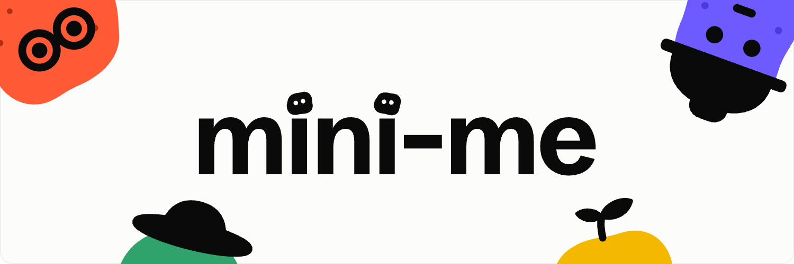

<p align="center">
  
</p>

Mini-Me (v2) is a local-first, customizable desktop research tool for scientists at the
[International Potato Center (CIP)](https://cipotato.org), building on its predecessor,
[Mini-Me Desktop](https://github.com/CENTRO-INTERNACIONAL-DE-LA-PAPA/mini-me-desktop).

Instead of asking scientists to adopt a new way of working, Mini-Me lets them build
**Mini-Mes**: small versions of themselves that carry out research the way they already
would without AI. A Mini-Me helps gather everything a project needs, from ideas and
hypothesis validation to experiments and results.

## Core concepts

| Concept | What it is |
|---|---|
| **Project** | Where your work lives: its Conversations and files, with an overview of progress. |
| **Conversation** | A chat inside a Project, where you ask Mini-Mes for help. |
| **Mini-Me** | Your "little scientist", defined by its **Traits** and its **Workflow**. Use the predefined ones, or build your own in a visual editor. |
| **Trait** | One thing a Mini-Me can do, such as *Find Papers* or *Summarize*. |
| **Workflow** | The order a Mini-Me uses its Traits in, with points where it stops for your approval. |

A Mini-Me for literature review might have the Traits *Find Papers*, *Summarize* and
*Refute*, with this Workflow:

```
Find Papers ──► Summarize ──► [you approve] ──► Refute
```

You invoke a Mini-Me with `@`. When you don't, Typesafe's Jev picks the most suitable one,
and if it isn't confident enough, Assistant answers.

## How it works

Mini-Me runs on your computer. Your Projects, with their Conversations and files, are stored in
a `Mini-Me Data` folder in Documents, one folder per Project:

```
Mini-Me Data/
└── <project>/
    ├── project.sqlite   # conversations, messages and the Project Overview
    └── assets/          # uploaded and generated files
```

- **Your work stays local.** A Mini-Me can only read and write inside the folder of the Project
  it is working in.
- **You bring your own AI.** You choose the provider and the model and use your own API key.
  Requests go straight from your computer to that provider, and your keys are kept in your
  system's keychain.
- **You stay in control.** A Workflow can stop for your approval before it continues, and
  Mini-Me asks before any action that would cost extra.
- **Some Traits use other services:** Ai2's Asta to find papers and build theories, with your
  own Ai2 account, and Typesafe's Jev to choose a Mini-Me for you.

## Installation

Download the file for your system from the latest
[release](https://github.com/CENTRO-INTERNACIONAL-DE-LA-PAPA/mini-me-v2/releases/latest).
The installers are not code-signed, so each system warns the first time:

- **Windows:** `Mini-Me_<version>_x64-setup.exe`. It installs Mini-Me for your Windows user
  only, into `%LOCALAPPDATA%\Mini-Me`, and needs no administrator rights. When SmartScreen
  warns "Windows protected your PC", click **More info**, then **Run anyway**.
- **macOS** (Apple silicon): `Mini-Me_<version>_aarch64.dmg`. Open it and drag Mini-Me into
  Applications. If macOS says Mini-Me "is damaged" or can't be verified, run
  `xattr -dr com.apple.quarantine /Applications/Mini-Me.app` in Terminal once, then open it.
- **Linux** (x86-64): `Mini-Me_<version>_amd64.AppImage` runs on most distributions; make it
  executable (`chmod +x Mini-Me_*.AppImage`) and run it. On Ubuntu and Debian you can install
  `Mini-Me_<version>_amd64.deb` instead, with `sudo apt install ./Mini-Me_<version>_amd64.deb`
  so that its dependencies come with it. Mini-Me keeps your API keys in the desktop's keyring
  (GNOME Keyring or KWallet), which Ubuntu's desktop already runs; without one, keys cannot be
  saved.

Mini-Me updates itself: it downloads new versions in the background, shows the progress in
the sidebar and offers **Restart**, or installs the update when you close it. Your Projects
and settings are kept. The Linux `.deb` does not update itself; install the new `.deb` from
each release.

You bring your own API key for the AI provider you choose. [docs/using.md](docs/using.md) walks
through adding it, and explains how to work with Mini-Mes.

### Mini-Me Canary

Mini-Me Canary is the build for beta testers. It gets every change as soon as it is merged, before
it is released, so it can break. It installs next to Mini-Me as a separate app, with its own
Projects (`Documents/Mini-Me Data (Canary)`), settings and API keys. Keep work that matters in
Mini-Me.

Download it from the newest "Mini-Me Canary" pre-release on the
[releases page](https://github.com/CENTRO-INTERNACIONAL-DE-LA-PAPA/mini-me-v2/releases), not from
the one called "Mini-Me Canary update feed". The files and the first-launch warnings are the ones
described above, under the name "Mini-Me Canary". It updates itself to each new build.

- **Windows:** it installs into `%LOCALAPPDATA%\Mini-Me Canary`. On a CIP computer, IT has to
  allow `%LOCALAPPDATA%\Mini-Me Canary\sidecar\python\python.exe`, as it does for Mini-Me's.
- **Reporting a problem:** Settings → About shows the commit the build was made from, such as
  "Mini-Me Canary a1b2c3d". Include it.

## Development

Mini-Me is a [Tauri](https://tauri.app) app with a React UI, a Rust core and a Python sidecar.
To contribute:

- **Changes are specified first.** Each one is an [OpenSpec](openspec/) change, with its
  proposal, specs and tasks, before any code is written.
- **Work lands on `dev`** through a pull request, where the tests run. `main` holds the released
  versions.
- **Commits and pull request titles** follow
  [Conventional Commits](https://www.conventionalcommits.org).

[docs/development.md](docs/development.md) covers running the app from source, the tests,
Canary builds and releases, and [docs/architecture.md](docs/architecture.md) explains how the
parts work together.

## License

Mini-Me is free software, released under the
[GNU General Public License, version 3 or later](LICENSE). You may use, study, change and
share it, including commercially. Anyone who distributes Mini-Me, changed or not, must do so
under the same license, pass on the source code, and keep the [NOTICE](NOTICE) crediting the
International Potato Center (CIP).

## Acknowledgements

**Mini-Me** is developed by and for the
[International Potato Center (CIP)](https://cipotato.org).

### Asta

Several Traits, including *Find Papers* and *Theorize*, are powered by
[Asta](https://allenai.org/asta), the scientific research agent suite from the
[Allen Institute for AI (Ai2)](https://allenai.org/). Mini-Me uses Asta through
[allenai/asta-plugins](https://github.com/allenai/asta-plugins), which is licensed under
Apache 2.0.

If your research uses output produced with Asta, please cite:

> Bragg, J., D'Arcy, M., Balepur, N., Bareket, D., Dalvi, B., et al. (2026).
> *AstaBench: Rigorous Benchmarking of AI Agents with a Scientific Research Suite.*
> International Conference on Learning Representations (ICLR 2026).
> [arXiv:2510.21652](https://arxiv.org/abs/2510.21652)

<details>
<summary>BibTeX</summary>

```bibtex
@inproceedings{bragg2026astabench,
  title         = {AstaBench: Rigorous Benchmarking of AI Agents with a Scientific Research Suite},
  author        = {Bragg, Jonathan and D'Arcy, Mike and Balepur, Nishant and Bareket, Dan and Dalvi, Bhavana and others},
  booktitle     = {International Conference on Learning Representations (ICLR)},
  year          = {2026},
  eprint        = {2510.21652},
  archivePrefix = {arXiv},
  primaryClass  = {cs.AI},
  doi           = {10.48550/arXiv.2510.21652}
}
```

</details>

### Built with

[Tauri](https://tauri.app), [React](https://react.dev), [Tailwind CSS](https://tailwindcss.com),
[shadcn/ui](https://ui.shadcn.com), [Observable Plot](https://observablehq.com/plot/) for
charts, [react-markdown](https://github.com/remarkjs/react-markdown) for formatted replies,
[LangGraph](https://www.langchain.com/langgraph), [pandas](https://pandas.pydata.org)
and [pointblank](https://posit-dev.github.io/pointblank/) for the data Traits, and
[Typesafe Jev](https://docs.typesafe.ai) for routing.

### Use of generative AI

Parts of this project's planning and documentation were prepared with the help of
generative AI. AI-assisted content is reviewed before it is relied on.

<p align="center">
  
</p>